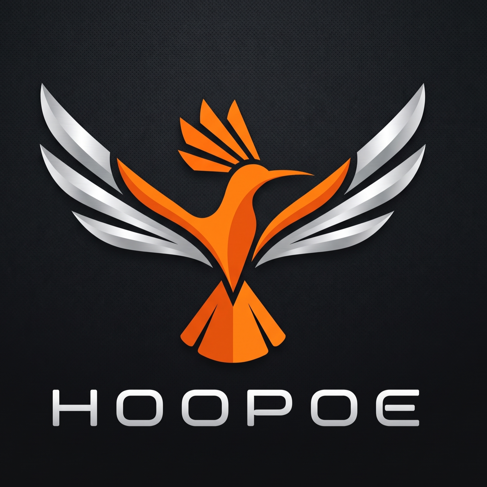

# 🚗🦅 Hoopoe Car Companion

> **Smart Automotive Cockpit, Navigation HUD & Redwing AI Travel Buddy**  
> An all-in-one automotive companion featuring real-time map navigation, automated hardware GPS speedometer, Redwing combat drone AI travel buddy, Islamic prayer times, Travel Dua recitation, offline map caching, and EPA standard fuel/CO₂ emission logging.



---

## 🌟 Key Features

### 1. 🏎️ Automotive Instrument Cluster & GPS Speedometer (Left Column)
- **High-Contrast Digital HUD Speedometer**: Features a 270° circular LED arc gauge with color-coded safety zones (emerald safe, amber caution, crimson danger).
- **Automotive Hardware GPS Integration**: Automatically derives vehicle velocity and ground speed from real browser geolocation and Haversine delta equations.
- **Dynamic Speed Limit Monitoring**: Live posted speed limit badge (`LIMIT 80`) with automated audio-visual overspeed warnings.
- **Transmission Shifter**: Active automotive gear selector buttons (`P`, `R`, `N`, `D`, `S`).
- **Telemetry Indicators**: Real-time Engine Ignition status toggle, Trip Distance odometer, Fuel level gauge, and unit switching (`km/h` ⇄ `mph`).
- **Live Eco-Driving & EPA Telematics**: Displays real-time cruising efficiency and instant CO₂ output.

### 2. 🗺️ Interactive Centre Navigation Map (Centre Column)
- **Night-Mode Cockpit Map**: High-performance Leaflet navigation interface styled for low-light automotive driving.
- **Embedded Search & Route Direction**: Search landmarks, airports, plazas, and mosques with automatic turn-by-turn routing, distance calculations, and ETA estimates.
- **Turn-by-Turn HUD Banner**: Top navigation bar displaying distance to next maneuver and real-time street directions.
- **Live Traffic Flow Layer**: Multi-colored polyline overlay representing smooth (green), moderate (orange), and congested (red) traffic with speed bottleneck badges.
- **En-Route Rain Radar**: Dynamic Doppler precipitation overlay alerting drivers ahead of wet highway sections.
- **Integrated Fuel Station Locator**: Interactive markers for highway service plazas (Aramco, Shell, Petronas, ADNOC) with live fuel prices and roadside amenities (Musalla, Halal Cafe, EV fast charging, 24/7 Car Wash).
- **Drive Simulation Controls**: Play, pause, and reset driving simulation to preview routes and trip alerts.

### 3. 💾 Offline Google Map Saving & Caching
- **Browser CacheStorage & IndexedDB Engine**: Save route tiles and geographic regions locally for driving without cellular network coverage.
- **Offline Storage Manager**: Displays number of cached tiles and storage space used (MB) with 1-click cache updates.
- **Offline Mode Navigation Switch**: Toggle simulated zero-network navigation with a persistent HUD badge.

### 4. 🦅 Redwing AI Travel Buddy (Right Column)
- **Avengers Combat Drone Mascot**: Designed after Falcon / Sam Wilson's **EXO-7 Redwing** reconnaissance drone from Marvel Avengers, featuring crimson armor plating, swept variable-geometry delta wings, a glowing HUD cyclopean scanner eye, and animated dual ion micro-thrusters with pulsing plasma exhaust.
- **Spontaneous Friendly Banter**: Redwing casually and spontaneously drops conversational thoughts every 90–120 seconds while cruising (weather observations, music commentary, road break reminders, and dhikr).
- **Interactive Touch Feedback**: Tap Redwing’s wings anytime for an instant friendly travel remark.
- **Driver Name Callouts**: Redwing addresses the driver naturally by their custom name in all emergency alerts and casual remarks.

### 5. 🕌 Islamic Travel Features & Authentic Arabic Pronunciation
- **Opening Travel Dua Modal**: Recitation of the authentic travel prayer (*Dua as-Safar*, Sahih Muslim 2392) in Arabic with complete Tamil phonetic transliteration.
- **Islamic Greeting Banner**: Welcoming *Fi Amanillah* post-dua banner with automatic chime.
- **Upcoming Prayer Times**: Displays upcoming Salah (Fajr, Dhuhr, Asr, Maghrib, Isha) with real-time minute countdowns and 1-click roadside Musalla navigation.
- **Authentic Arabic Phonetic Engine**: Proprietary phonetic processor (`phoneticizeArabicPhrases`) that tunes sacred Arabic words (*Fi Amanillah*, *Assalamu Alaikum*, *Alhamdulillah*, *SubhanAllah*, *Allahu Akbar*, *Dua Safar*) so standard browser and system speech engines pronounce them with proper Arabic phonetics and vowel elongation.

### 6. 📻 Radio cum FM & In-Cabin Music Player (Right Column)
- **FM Radio Tuner**: Frequency dial (88.0 – 108.0 MHz) powered by a Web Audio harmonic oscillator synthesizer simulating authentic analog radio reception.
- **Integrated Media Player**: Inbuilt playlist featuring Surah Al-Mulk (Mishary Alafasy), Morning & Evening Adhkar (Hisn al-Muslim), Acoustic Nasheed harmonies, and Highway Lo-Fi beats.

### 7. 🌿 Standard EPA & Argonne National Laboratory (ANL) Emissions
- **EPA Gasoline Model**: Calculates driving CO₂ based on the standard **2,392 g CO₂ per liter** factor.
- **Argonne National Lab (ANL-GREET) Idle Model**: Monitored idle fuel loss rate of **0.6977 g CO₂/sec** (1.05 L/hr idle rate).
- **Automated 40s Idle Alert**: When stopped with ignition running for > 40 seconds, Redwing alerts the driver to turn off the engine and prevent fuel waste.

### 8. ⛽ Manual Petrol & Expense Logger
- Refill logbook tracking volume in liters, total expense ($), service station name, odometer reading, and custom notes with full local persistence.

### 9. 📊 Ignition-Based Trip Log & Post-Ride Driving Rating
- **Trip Telematics**: Automatically tracks trip start/end times, distance, duration, top speed, and total carbon footprint based on ignition state.
- **Driving Performance Rating Scorecard**: Triggered upon turning off the ignition or finishing a ride; calculates an overall score (0–100), letter grade (A+ to D), safety index, eco-efficiency score, and tailored driving recommendations.

### 10. ⚙️ Voice Settings & Driver Profile
- **Customizable Driver Name**: Set what Redwing and the audio system call you.
- **System Speech Voice Selector**: Dropdown supporting all installed system speech synthesis voices.
- **Audio Controls**: Sliders for Pitch (0.8x – 1.4x), Speech Rate (0.8x – 1.3x), and Volume (0% – 100%).
- **Test Voice Preview**: Plays a live greeting sample calling the user by name.

---

## 📱 Multi-Platform Deployment & Android APK Installation

The application includes full **Progressive Web App (PWA)**, **Android WebAPK**, and **Capacitor native Android** support:

### Option 1: Direct On-Device WebAPK Install
1. Open the app link in **Google Chrome** on your Android device:
   ```
   https://ais-pre-nvonhn7yskqyazeqwydrre-836165470922.asia-northeast1.run.app
   ```
2. Tap the **"Install APK"** button in the cockpit header (or Chrome menu `⋮` → **Install app**).
3. Android OS automatically compiles and signs a native `.apk` (`com.android.chrome.webapk.*`), installing Hoopoe into your app drawer with fullscreen HUD, hardware GPS, and offline caching.

### Option 2: Automated GitHub Actions CI/CD Pipeline
This repository includes `.github/workflows/build-apk.yml`. Pushing to GitHub triggers an automated cloud build using Java 17 and Android SDK:
1. Create a repository on GitHub (e.g. `hoopoe-car-companion`).
2. Push your code:
   ```bash
   git remote add origin https://github.com/<YOUR_GITHUB_USERNAME>/hoopoe-car-companion.git
   git branch -M main
   git push -u origin main
   ```
3. Open the **Actions** tab in GitHub to download `hoopoe-car-companion-debug-apk.zip` from the build artifacts!

### Option 3: Cloud 1-Click APK Generator (PWABuilder)
Click **"Install APK"** in the cockpit header and open the **Cloud APK Builder** tab to generate a signed `.apk` or Google Play `.aab` package via PWABuilder in 30 seconds.

### Option 4: Local Android Studio Build
```bash
npm run build
npx @capacitor/cli add android
npx @capacitor/cli open android
```
In Android Studio: **Build → Build Bundle(s) / APK(s) → Build APK(s)** to generate:
`android/app/build/outputs/apk/debug/app-debug.apk`

---

## 💻 Tech Stack

- **Framework**: React 19 SPA with TypeScript
- **Styling**: Tailwind CSS v4 with dark automotive aesthetics
- **Build Tool**: Vite 8 & `vite-plugin-pwa`
- **Server**: Express backend (`server.ts`) with `@google/genai` (Gemini 3.8 Flash model) for natural companion conversations
- **Mapping**: Leaflet 1.9 with custom HUD vehicle markers
- **Audio**: Web Audio API oscillator synthesis & SpeechSynthesis with Arabic phonetic tuning
- **Mobile Packaging**: Capacitor, WebAPK, and GitHub Actions CI/CD

---

## 🚀 Local Development

```bash
# Install dependencies
npm install

# Start development server on port 3000
npm run dev

# Run unit tests (EPA models, GPS velocity, companion logic)
npx tsx --test src/utils/companionLogic.test.ts

# Production build
npm run build
```

---

## 📄 License
Apache-2.0
